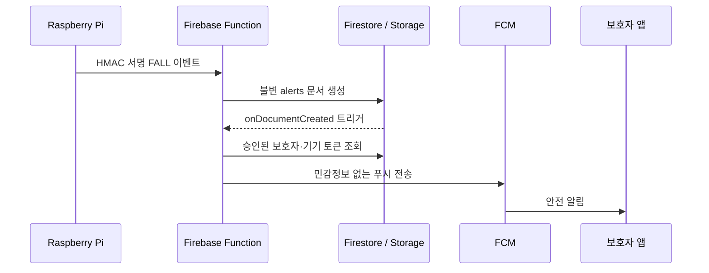

# CareGuard — 낙상 탐지·보호자 알림 Android 앱

`CareGuard`는 라즈베리 파이가 수행한 낙상 판정을 보호자에게 안전하게 전달하고, 안드로이드 휴대폰의 마이크·카메라·계정 기능을 보조 수단으로 사용하는 Kotlin/Jetpack Compose 프로젝트입니다.

- **라즈베리 파이:** 기존 낙상 탐지 모델이 `FALL` 이벤트를 HMAC 서명해 Firebase Function으로 보냅니다.
- **휴대폰 마이크:** 사용자가 직접 시작하는 짧은 한국어 음성 인식 세션입니다. 최종 결과에 위험 문구가 있어도 앱에서 다시 확인해야 알림을 보냅니다.
- **휴대폰 카메라:** 사용자가 직접 녹화한 짧은 현장 영상을 Firebase Storage로 업로드합니다. ML Kit 물체 분류 요약도 함께 저장하지만, 이 화면은 낙상을 판정하지 않습니다.
- **보호자:** 회원가입 뒤 이메일로 요청을 보내고, 상대방이 수락한 경우에만 FCM 푸시 알림 대상이 됩니다.

## 전체 흐름



휴대폰 SOS, 위험 음성 확인, 현장 영상 전송도 같은 `alerts` 문서를 만들고 동일한 보호자 알림 흐름을 사용합니다. 푸시에는 `alertId`, `patientId`, `type`만 넣고 상세 정보는 인증된 Firestore/Storage 접근으로 확인하도록 설계했습니다.

## 프로젝트 구성

```text
app/                         Android Studio Kotlin/Compose 앱
  src/main/java/.../data/     Firebase 인증, 영상 업로드, 보호자·Pi 페어링 Repository
  src/main/java/.../ui/       로그인, 홈, 영상, 음성, 마이페이지 화면
  src/main/java/.../service/  FCM 수신과 알림 채널
functions/src/index.ts        보호자 초대·수락, Pi HMAC 수신, FCM 발송
firestore.rules               Firestore 최소 권한 규칙
storage.rules                 영상 접근·업로드 크기 제한 규칙
raspberry_pi/                 기존 낙상 코드에 호출할 Python 전송 예제
```

## Android Studio 설정

1. Firebase Console에서 프로젝트를 만들고 Android 앱을 **`com.example.careguard`** 패키지명으로 등록합니다. 다른 패키지명을 쓰려면 `app/build.gradle.kts`의 `namespace`와 `applicationId`도 같은 값으로 함께 바꾸세요.
2. 내려받은 `google-services.json`을 `app/google-services.json`에 둡니다. 저장소에는 포함하지 마세요. 형식 안내 파일은 `app/google-services.json.example`입니다.
3. Firebase Authentication에서 **이메일/비밀번호** 로그인을 활성화합니다. Firestore Database와 Storage 버킷도 생성합니다.
4. Firebase 프로젝트에서 Cloud Functions와 Storage를 사용하려면 현재 Firebase 과금/할당량 요구사항을 확인하고 적절한 요금제를 연결하세요.
5. Android Studio에서 이 폴더를 열어 Gradle Sync를 실행합니다. 이 프로젝트는 `minSdk 26`, `targetSdk 35`, Java 17을 사용합니다.
6. 실제 기기에서 로그인한 다음, 홈의 **이 기기 알림 허용**을 눌러 Android 13 이상 알림 권한을 승인합니다. 보호자 기기에서도 별도로 승인해야 합니다.

Firebase Android SDK는 호환 버전 관리를 위해 BoM `35.1.0`을 사용하며, 2025년 이후 배포가 중단된 별도 `-ktx` 모듈을 사용하지 않습니다. Firebase Console에서 받은 파일을 넣기 전에는 Android 빌드가 `google-services.json` 누락으로 실패하는 것이 정상입니다.

## Firebase 규칙 및 Functions 배포

Firebase CLI를 설치하고 프로젝트 루트에서 다음을 실행합니다.

```bash
firebase login
firebase use --add                 # 이 Firebase 프로젝트 선택
cd functions
npm install
npm run lint
cd ..
firebase deploy --only firestore:rules,storage,functions
```

배포 후 Pi 수신 URL은 다음 형식입니다.

```text
https://asia-northeast3-YOUR_PROJECT_ID.cloudfunctions.net/receiveFallEvent
```

`functions/src/index.ts`와 앱은 모두 Seoul 리전 `asia-northeast3`을 사용합니다. 다른 리전을 쓸 경우 양쪽을 함께 바꾸세요.

## 라즈베리 파이 연동

1. 앱에서 로그인한 뒤 **마이페이지 → Pi 페어링 키 만들기**를 누릅니다.
2. 표시되는 `DEVICE_ID`와 `SHARED_SECRET`을 Pi의 비공개 환경 변수에 한 번만 저장합니다. 대화창을 닫으면 앱은 같은 비밀키를 다시 보여 주지 않습니다.
3. `raspberry_pi/.env.example`을 참고하여 아래 변수를 설정합니다.

```bash
export CARE_GUARD_FALL_INGEST_URL="https://asia-northeast3-YOUR_PROJECT_ID.cloudfunctions.net/receiveFallEvent"
export CARE_GUARD_DEVICE_ID="pi_..."
export CARE_GUARD_SHARED_SECRET="발급받은_비밀키"
```

4. 기존 낙상 모델이 낙상을 **확정**한 위치에서 `raspberry_pi/fall_event_sender.py`의 `send_fall_event()`를 호출합니다.

```python
from fall_event_sender import send_fall_event

# 기존 모델의 fall_confirmed 분기 예시
if fall_confirmed:
    # 네트워크 재시도 때 동일한 event_id를 재사용하면 서버가 중복 경보를 만들지 않습니다.
    result = send_fall_event(event_id=current_event_id)
    print(result)
```

Pi는 `deviceId.eventId.FALL.occurredAt` 문자열을 HMAC-SHA256으로 서명합니다. Cloud Function은 해당 Pi에 저장된 공유 비밀키로 검증한 뒤에만 알림 문서를 만듭니다. 따라서 Firebase 서비스 계정 키나 사용자 비밀번호를 Pi에 둘 필요가 없습니다.

## 보호자 연결 테스트

1. 피보호자 A와 보호자 B가 각각 앱에서 계정을 만들고 인증 링크를 눌러 이메일 인증을 완료합니다. 인증 전에는 안전 기능 화면에 진입할 수 없습니다.
2. A의 **마이페이지**에서 B의 이메일로 보호자 요청을 보냅니다.
3. B가 로그인해 **받은 보호자 요청**을 수락합니다.
4. B의 기기에서 알림을 허용한 뒤 앱을 한 번 열어 FCM 등록 토큰을 저장합니다.
5. A가 SOS를 보내거나 Pi에서 테스트 낙상 이벤트를 보냅니다.
6. B가 `CareGuard 안전 알림` 푸시를 받는지 확인합니다.

보호자 계정은 Firebase 이메일 인증을 완료해야 초대를 수락할 수 있습니다. Cloud Function은 Firestore 이벤트 재시도와 기기별 전송 상태를 기록하고, 일시 실패는 재시도하며 이미 성공한 기기는 건너뜁니다. 같은 Pi 이벤트는 `deviceId + eventId`로 문서 ID를 고정해 중복 경보 생성을 막습니다.

## 보안·개인정보 체크 항목

- 배포 전 반드시 `firestore.rules`, `storage.rules`를 함께 배포하세요. 클라이언트는 보호자 관계, Pi 비밀키, 서버 전달 상태를 직접 수정할 수 없습니다.
- 영상은 `evidence/{사용자UID}/{alertId}.mp4` 경로에만 저장되며, 본인 또는 승인된 보호자만 읽습니다. 다운로드 URL을 채팅, 로그, 푸시 페이로드에 넣지 마세요.
- Storage 규칙의 MIME·용량 검사는 25 MiB 제한을 위한 1차 방어입니다. 운영 서비스에는 Firebase App Check, 서버 측 파일 검사, 보존 기간·삭제 기능, 접근 로그와 개인정보처리방침을 추가하세요.
- 시스템 `SpeechRecognizer`는 단말 설정에 따라 음성을 원격 서버로 보낼 수 있고, 연속 인식용 API가 아닙니다. 현재 코드는 백그라운드 감청이나 자동 반복 재시작을 하지 않습니다.
- 앱 카메라는 포그라운드 화면에서만 녹화합니다. 백그라운드 카메라·마이크 녹화를 추가하려면 Android의 foreground service 정책, 명시적 동의, 지속 알림과 별도 권한을 검토해야 합니다.
- 기본 ML Kit 객체 분류는 패션·식품·가정용품·장소·식물 같은 거친 범주입니다. 낙상 자세를 휴대폰 카메라로 판별하려면 별도의 검증된 커스텀 모델과 안전성 평가가 필요합니다.

## 검증 상태

Firebase Functions는 `npm run lint`와 `npm run build`를 통과했습니다. 이 작업 환경에는 Android SDK와 Gradle이 설치되어 있지 않아 실제 APK 빌드·실기기 카메라·푸시 수신은 수행하지 않았습니다. `google-services.json`을 넣은 뒤 Android Studio의 Gradle Sync와 실제 Android 기기에서 위 보호자 연결 테스트를 진행하세요.

## 공식 문서

- [Firebase Android 설정 및 BoM](https://firebase.google.com/docs/android/setup)
- [Firebase Cloud Messaging Android 클라이언트](https://firebase.google.com/docs/cloud-messaging/android/client)
- [Firebase Admin SDK FCM 전송](https://firebase.google.com/docs/cloud-messaging/send/admin-sdk)
- [CameraX 동영상 녹화](https://developer.android.com/media/camera/camerax/video-capture)
- [ML Kit Android 객체 감지](https://developers.google.com/ml-kit/vision/object-detection/android)
- [SpeechRecognizer API](https://developer.android.com/reference/android/speech/SpeechRecognizer)
- [Android 13 이상 알림 권한](https://developer.android.com/develop/ui/views/notifications/notification-permission)
